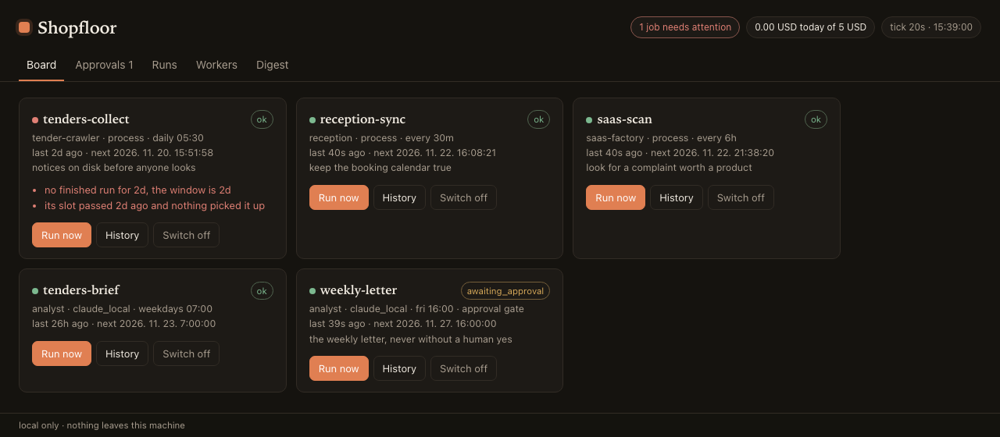

# Shopfloor

A shop floor for the AI agents you already run. It takes the work in, schedules it, keeps the run log, remembers what the job learned, counts the money, holds the risky work behind a human decision, tells you which job went quiet, and holds the finished work until you let it out.

Zero dependencies. One SQLite file. Node 22.5 or newer and nothing else.

```
npx github:kalmardani/shopfloor init
npx github:kalmardani/shopfloor serve
```



## Why it exists

Agent CLIs are good at work and bad at running a shop. A prompt in `cron` fires into the dark. A `launchd` plist that never loaded looks exactly like a plist that runs fine. A subscription burns through its quota at 2am and the morning looks normal. The failure nobody sees is the expensive one, and the agent frameworks that wrap the model do not solve it, because the gap is in the floor above them.

Shopfloor is that floor. Your scripts and prompts stay yours, unchanged. Shopfloor decides when they run, carries what arrived to the run that answers it, writes down what happened, hands the job what earlier runs learned, stops the work at a dollar ceiling, asks before anything leaves the building, and raises a hand when a job stops reporting.

An always on agent needs five things around the model. A place where new work arrives, a run that wakes up and does what is pending, memory that lives outside the agent, a gate in front of anything that acts, and a queue for what it finished. Shopfloor is those five, in one SQLite file, for the agent CLIs you already have.

The whole thing fits in a single file database and a web interface you can read in one sitting, because a supervisor you cannot read is one more thing to supervise.

## Install

```bash
git clone https://github.com/kalmardani/shopfloor.git
cd shopfloor
node bin/shopfloor.mjs init
```

There is nothing to compile and nothing to download. `npm install` is not needed, because the package has no dependencies.

Optionally put it on your path.

```bash
npm link                 # gives you the shopfloor command
shopfloor --help
```

Everything lives in `~/.shopfloor` (`shopfloor.db` and `config.json`). Point `SHOPFLOOR_HOME` somewhere else if you want more than one shop.

## Five minutes from here

A shell script you already have, watched from now on.

```bash
shopfloor worker add nightly --adapter process \
  --command "node ~/Developer/my-thing/run.mjs" --cwd ~/Developer/my-thing
shopfloor job add nightly-build --worker nightly --schedule "daily 02:30" \
  --goal "build the report so it is ready before breakfast"
shopfloor serve
```

A prompt through the Claude Code CLI on this machine, on your plan, with a daily ceiling.

```bash
shopfloor worker add researcher --adapter claude_local \
  --model claude-opus-5 --cwd ~/Developer/notes --cap 2 \
  --allow-tools "Read,Grep,WebSearch"
shopfloor job add morning-scan --worker researcher --schedule "weekdays 07:00" \
  --prompt "Read today's notes and write three lines about what changed."
```

Work that must never go out on its own.

```bash
shopfloor job add weekly-letter --worker researcher --schedule "fri 16:00" --approval \
  --prompt "Draft the weekly client letter from this week's notes."
shopfloor approvals
shopfloor approve 1a2b3c4d
```

Work that arrives instead of waiting for the clock. The job sits on `manual`, and an event wakes it.

```bash
shopfloor job add inbox-watcher --worker researcher --schedule manual \
  --prompt "Answer what arrived. End with ::memory last_seen = <the id you just handled>."
shopfloor inbox add inbox-watcher --message "a new tender landed in ./in" --key tender-4812
shopfloor inbox url inbox-watcher        # the curl line another system posts to
shopfloor memory inbox-watcher           # what the job knows, and which run wrote it
```

Finished work that waits for you before it goes anywhere.

```bash
shopfloor outbox                         # what is queued, and whether sending is on at all
shopfloor config outboxSend true
shopfloor config outboxCommand "~/bin/send-email.sh"
shopfloor approvals                      # one entry, one decision
shopfloor approve 9f8e7d6c
```

Something that runs outside Shopfloor and should be missed when it dies.

```bash
shopfloor job add tender-crawler --worker nightly --schedule "every 6h"
shopfloor heartbeat tender-crawler
# put the printed curl line at the end of the launchd script
```

And every morning, in one text.

```bash
shopfloor digest
shopfloor doctor
```

## What it gives you

**Jobs and workers.** A worker is how work gets done (a command, a prompt, a webhook) with its own ceiling. A job is a worker on a schedule with a goal written down. Both are rows in one SQLite file you can read with any tool.

**Schedules in words.** `every 15m`, `daily 07:30`, `weekdays 08:00`, `mon 09:00`, `monthly 1 09:00`, `manual`, and five field cron when you want it. A schedule nobody can read is refused when you type it, not at 3am.

**A run log that keeps the output.** Status, exit code, duration, cost, the tail of stdout and stderr. Status is one of `ok`, `fail`, `timeout`, `quota`, `blocked`, `awaiting_approval`, `rejected`, `cancelled`, `lost`.

**An event inbox.** Four things can wake a job. A message you type, a webhook another system posts to `/in/<token>`, the timer, and the answer of an earlier run. Every arrival carries a dedupe key, so the same event never starts two runs, and one inbox is worked by one run at a time. The timer writes its own firing into the inbox too, which makes the inbox one ledger of every reason a run ever started.

**Memory outside the agent.** Key and value under the job, each with the run that wrote it and when, because a memory that can be written can be poisoned. A run starts with that memory in front of its prompt and writes back with one line of its own output. Store what the agent cannot look up again, and store a pointer to everything else.

**An outbox that starts quiet.** A run leaves its result as an outbox entry rather than as a message already gone. Sending is off until you turn it on, each entry asks the same approval gate a job does, and delivery is paced, so a run that writes twenty entries does not post twenty messages in one second. Whatever carries them is your own command, which keeps mail, Telegram and a file on disk equally possible.

**Silence alarms.** The thing `cron` cannot do. Every job carries a window, two missed slots wide by default. Past it, the job turns up in `shopfloor doctor`, in the morning digest, in the web board, and in `/api/health` as a 503 your own monitoring can poll. Four kinds of quiet are caught: no finished run inside the window, a slot that passed with nothing picking it up, two failures in a row, and a dead man's switch that stopped pinging.

**Money ceilings.** A daily cap for the whole shop and a cap per worker. The `claude_local` adapter reads back the cost the CLI reports, so the numbers are measured rather than guessed. Over the cap, the run is recorded as `blocked` instead of starting.

**Quota patience.** When an agent CLI says the plan is out of room, the run is marked `quota` and the job is pushed out half an hour, with no retry storm and no false failure.

**Approval gates.** A job marked `--approval` creates a run that waits. Approve it from the web interface or the command line and it goes through. Reject it with a note and the reason stays in the log. Mail, posts and deploys belong here.

**A morning digest.** One text with what needs attention, what waits for a decision, what ran, what failed and what it cost. `notifyCommand` in the config receives it on standard input, so Telegram, mail, a file or a desktop banner all work without this project growing a dependency.

**A web interface.** Board, approvals, runs with full output, workers, digest. Served from `src/ui`, three files, no build step, local only unless you change the host.

## Adapters

| adapter | what it runs | cost | notes |
| --- | --- | --- | --- |
| `process` | any shell command | 0 | your scripts stay yours |
| `claude_local` | the local `claude` CLI, headless | read from the CLI | plan sign-in or `CLAUDE_CODE_OAUTH_TOKEN`, no API key |
| `codex_local` | the local `codex` CLI | not reported | reads the sign-in in `~/.codex/auth.json` |
| `http` | a webhook on another machine | 0 | judged by the response status |

Every adapter is handed what the job knows and what woke it up. A prompt adapter puts both in front of the prompt, and `process` passes them as `SHOPFLOOR_MEMORY`, `SHOPFLOOR_EVENT` and `SHOPFLOOR_EVENT_SOURCE`, so a shell script reads them with `$`.

A headless agent run has nobody to click an allow button. Give `claude_local` an `--allow-tools` list, or `--skip-permissions` when you know what that means. The gate that protects you is the approval step in front of the job.

## What a run can say back

A run talks to the shop floor through its own output. One marker at the start of a line, nothing else needed, no socket and no second protocol. Prose that mentions a marker inside a sentence stays prose.

```
::memory last_seen = 4812
::pointer notes = ~/Developer/notes/2026-11.md
::forget last_seen
::reply other-job the file you wanted is on disk
::outbox channel=email to=dani@example.com subject=Weekly letter key=week-48
Dear Dani,

the week went well.
::end
```

Memory writes land under the job with the run id on them. A reply becomes an inbox event for the job you name, or for the same job with `self`, so one run can hand work to the next. An outbox block becomes an entry that waits. Only a run that ended well is read this way, because half of a crashed answer is not an instruction.

A prompt that uses this says so plainly. End your answer with `::memory last_seen = <the id you handled>`, and the next run starts knowing it.

## Running it for real

Keep `shopfloor serve` alive and it both serves the interface and ticks the scheduler. On macOS a `launchd` plist is in `examples/`. Elsewhere, a unit file or a `tmux` window does the same.

If you would rather not keep a process alive, let the system scheduler call one pass.

```
*/5 * * * * /usr/local/bin/node /path/to/shopfloor/bin/shopfloor.mjs tick
```

## Security

It binds to `127.0.0.1` and asks for nothing. That is the right setting for a laptop and the wrong one for a shared machine, so set a token before you move the host.

```bash
shopfloor config token "$(openssl rand -hex 16)"
shopfloor config host 0.0.0.0
```

The token guards every `/api/` route. The heartbeat route and the webhook door are guarded by their own secrets, because an outside process has to reach them with one `curl` and no headers. The webhook door takes a POST and nothing else, so a browser that wanders in cannot queue work. A job that is fed from outside is a job someone else can wake, which is the reason the outbox starts quiet. Shopfloor runs commands you put in it, so treat the config and the database as what they are, a list of things that will run as you.

## Configuration

`~/.shopfloor/config.json`, all optional.

| key | default | meaning |
| --- | --- | --- |
| `host`, `port` | `127.0.0.1`, `7420` | where the interface listens |
| `token` | `null` | bearer token for the api |
| `tickSeconds` | `20` | how often the scheduler looks around |
| `maxConcurrentRuns` | `2` | runs allowed at once |
| `maxUsdPerDay` | `5` | ceiling for the whole shop |
| `defaultTimeoutSec` | `900` | per run, unless the job says otherwise |
| `retryAfterQuotaSec` | `1800` | how long to wait out a hit quota |
| `keepRunOutputChars` | `20000` | tail of output kept per run |
| `keepRunDays` | `90` | run history kept |
| `digestAt` | `07:30` | when the daily digest is written |
| `notifyCommand` | `null` | shell command that receives the digest |
| `outboxSend` | `false` | whether anything in the outbox may leave at all |
| `outboxCommand` | `null` | shell command that receives one entry as JSON |
| `outboxRequiresApproval` | `true` | every entry asks a human first |
| `outboxPerTick` | `1` | deliveries allowed in one pass |
| `outboxMinGapSec` | `60` | quiet time between two deliveries |
| `outboxTimeoutSec` | `120` | per delivery |
| `memoryValueChars` | `2000` | longest value a run may write |
| `memoryBlockChars` | `4000` | longest memory block put in front of a prompt |

## Importing a shop in one file

```bash
shopfloor import examples/shop.json
```

See `examples/shop.json` for the shape.

## Tests

```bash
node --test
```

Forty nine tests over the schedule grammar, the run lifecycle, timeouts, budget ceilings, approval gates, silence detection, heartbeats, the inbox and its dedupe key, memory and its provenance, the outbox with its pacing and its gate, the directive parser, and the http api. No test needs the network, and none calls an agent CLI.

## What it is not

Not an agent framework. It does not write prompts, split tasks or route between models. Not a hosted service, because nothing leaves the machine. Not a replacement for a serious queue, as a single process with a SQLite file is honest about its size.

## Licence

MIT. Built by [Kalmár Dániel](https://www.kdconsulting.hu), AI consultant, with Claude Code.
